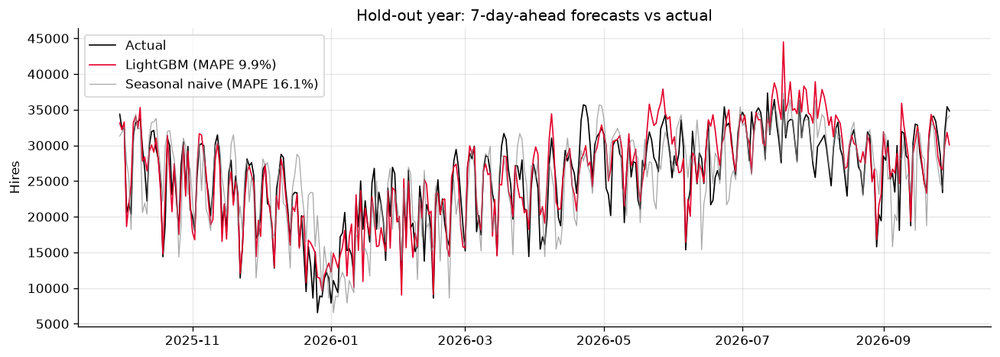
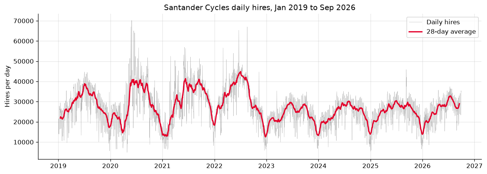
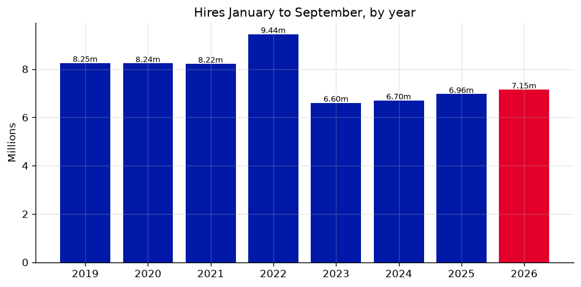
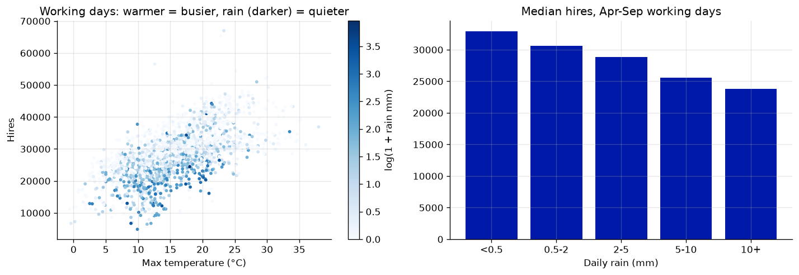
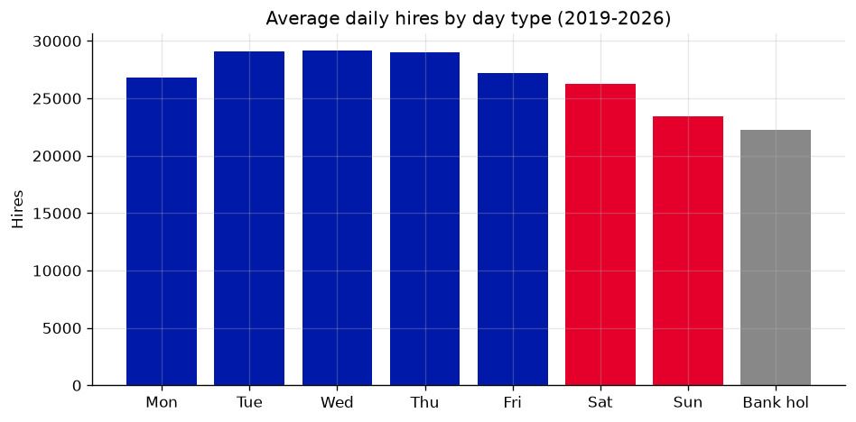
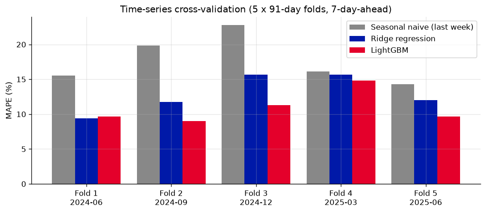
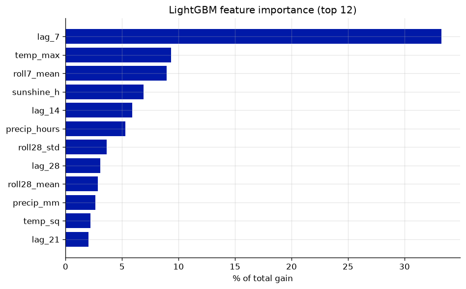

# Forecasting London's Santander Cycles demand: weather, calendar and gradient boosting

An end-to-end machine learning project that forecasts daily **Santander Cycles (TfL cycle hire)** journeys
**7 days ahead**. It joins TfL's official daily hire counts (Jan 2019 to Sep 2026) with real historical weather
from **Open-Meteo** and **GOV.UK bank holidays**. A leakage-safe feature pipeline (tested with pytest) feeds a
seasonal-naive baseline, a ridge regression and a **LightGBM** model. The models are compared with expanding-window
time-series cross-validation and a final hold-out year. The trained model is saved, every run is logged to an
experiment-tracking file, CI runs on GitHub Actions, and there is a Streamlit app.

Author: Anthony Adusei-Poku ([@anthony07-max](https://github.com/anthony07-max))



## Key findings

**Model performance (7-day-ahead, daily hires)**

| Model | CV MAE (5 folds, Jul 2024 to Sep 2025) | CV MAPE | Hold-out MAE (Sep 2025 to Sep 2026) | Hold-out MAPE |
|---|---|---|---|---|
| Seasonal naive (same day last week) | 3,755 | 17.7% | 3,329 | 16.1% |
| Ridge regression | 2,869 | 12.9% | 2,811 | 12.7% |
| **LightGBM** | **2,450** | **10.9%** | **2,242** | **9.9%** |

1. **LightGBM cuts the forecast error by 32.7% against the naive baseline** on the unseen hold-out year (MAE 2,242
   against 3,329 hires a day, MAPE 9.9%). It has the lowest MAE in all 5 CV folds (ridge has a slightly lower MAPE in fold 1).
2. **Weather is the biggest driver after recent demand.** Last week's same-day count explains 33.3% of the model's
   gain, then max temperature (9.3%), the recent 7-day average (8.9%) and sunshine hours (6.9%).
3. **Rain cuts demand by about a fifth.** On April to September working days, the median is **32,950 hires** on dry
   days (<0.5 mm) and **25,534** on days with 5 mm or more of rain (**-22.5%**). On working days, each extra °C of
   maximum temperature is worth about **+741 hires** (simple linear fit).
4. **It is a commuter network.** Tuesday to Thursday average about 29,000 hires (Wednesday is highest at 29,187),
   Sunday is lowest at 23,464, and bank holidays average 22,273.
5. **Demand is recovering but is still below 2019.** January to September 2026 had **7.15m hires, +2.6% on 2025**,
   but 13.4% below the same months of 2019 (8.25m). Annual totals peaked at **11.51m in 2022** and fell to 8.53m in
   2023. The busiest day in the data is **30 May 2020 (70,170 hires)**, a sunny Saturday as the first lockdown eased.
6. **The largest errors are unusual days the features cannot see.** For example, on 2 Aug 2026 there were 25,503 hires
   against a forecast of 38,929, and on 11 Feb 2026 13,769 against 25,251.

| | |
|---|---|
|  |  |
|  |  |
|  |  |

## Method
- **Target**: TfL's daily count of Santander Cycles hires, 1 Jan 2019 to 30 Sep 2026 (2,830 days). Three outage
  days with fewer than 1,000 hires (10 and 11 Sep 2022 with 0, and 5 Aug 2025 with 188) are excluded from training
  and scoring. They are set to missing so they never feed a lag.
- **Features** (`src/features.py`):
  - Calendar: weekday, weekend, month, day-of-year sine and cosine, GOV.UK bank holiday, Christmas period, non-working day.
  - Weather: max and mean temperature, rain mm and rain hours, max wind, sunshine and daylight hours.
  - Interactions: rain x weekend, temperature squared.
  - Demand history: lags of 7, 14, 21, 28 and 364 days, plus 7-day and 28-day rolling mean and standard deviation, all ending at t-7.
- **No leakage**: every demand feature for day *t* uses data from *t-7* or earlier, so this is a genuine one-week-ahead
  forecast. A unit test checks that changing day *t*'s count does not change any feature for days *t* to *t+6*.
  Weather is the observed value, so in production it would come from a weather forecast. The scores are therefore a
  best case for the weather part.
- **Validation**: expanding-window `TimeSeriesSplit` (5 folds of 91 days) on the development period, then a final
  hold-out of the last 365 modelled days. Training rows start in Jan 2020, because the 364-day lag needs a year of history.
- **Model**: LightGBM (600 trees, learning rate 0.03, 31 leaves, row and column subsampling), refit on all data and saved to
  `models/lgbm_cycle_hires.joblib`.
- **Experiment tracking**: each `src/train.py` run appends one JSON line to `experiments/runs.jsonl`. It records the git commit,
  data range, features, parameters, CV and hold-out metrics.
- **Tests and CI**: `tests/test_features.py` (8 tests) runs on a fixture of the first 400 real days. GitHub Actions
  (`.github/workflows/ci.yml`) runs the tests and a smoke test that the saved model loads and predicts.

## Data sources and licences
- **TfL / London Datastore**: [Number of Bicycle Hires](https://data.london.gov.uk/dataset/number-bicycle-hires),
  daily series (file `tfl-daily-cycle-hires-sep26-update.xlsx`). Contains Transport for London data, published under the
  [Open Government Licence v2.0](https://www.nationalarchives.gov.uk/doc/open-government-licence/version/2/).
  See also TfL's [cycling open data](https://cycling.data.tfl.gov.uk/).
- **Weather**: [Open-Meteo Historical Weather API](https://open-meteo.com/en/docs/historical-weather-api), daily
  values for central London (51.507 N, 0.128 W). Licensed under [CC BY 4.0](https://creativecommons.org/licenses/by/4.0/);
  weather data by Open-Meteo.com.
- **Bank holidays**: [GOV.UK bank holidays JSON](https://www.gov.uk/bank-holidays.json) (England and Wales), under the
  [Open Government Licence v3.0](https://www.nationalarchives.gov.uk/doc/open-government-licence/version/3/).

## Project structure
```
src/download.py      # fetches the hires workbook, weather JSON and bank holidays into data/raw/
src/features.py      # cleaning and leakage-safe feature engineering (tested)
src/clean.py         # merges the inputs into data/processed/daily.csv and features.csv
src/train.py         # time-series CV, hold-out test, saved model, experiment log
src/analysis.py      # descriptive stats, charts, key_findings.json
tests/               # pytest tests for the feature pipeline, real-data fixture
app/streamlit_app.py # dashboard and what-if forecaster
models/              # saved LightGBM model
experiments/runs.jsonl
.github/workflows/ci.yml
```

## How to run
```bash
python -m venv .venv && source .venv/bin/activate
pip install -r requirements.txt
./run_pipeline.sh                      # download, clean, test, train, analyse
streamlit run app/streamlit_app.py     # app at http://localhost:8501
pytest -q                              # feature pipeline tests only
```

## Limitations
- The model does not know about events that change demand: **Tube and rail strikes** (which push people onto bikes),
  docking-station closures, large events, or changes to pricing and fleet (for example, e-bikes). The series falls sharply
  between 2022 and 2023. TfL changed Santander Cycles pricing in autumn 2022, so compare years across that break with care.
- Hires are counted by TfL, and the London Datastore notes that recent daily figures can change slightly for about two weeks
  after first publication.
- The weather comes from one grid point in central London and is the observed weather, not a forecast that was available
  in advance, so real-world accuracy would be a little lower.
- This is a daily total for the whole scheme. Station-level demand (for rebalancing) would need TfL's journey-level
  usage files from cycling.data.tfl.gov.uk.
- Covid-era behaviour in 2020 and 2021 is still in the training data. The model has no explicit lockdown flag and relies on
  the recent-demand features to adapt.
